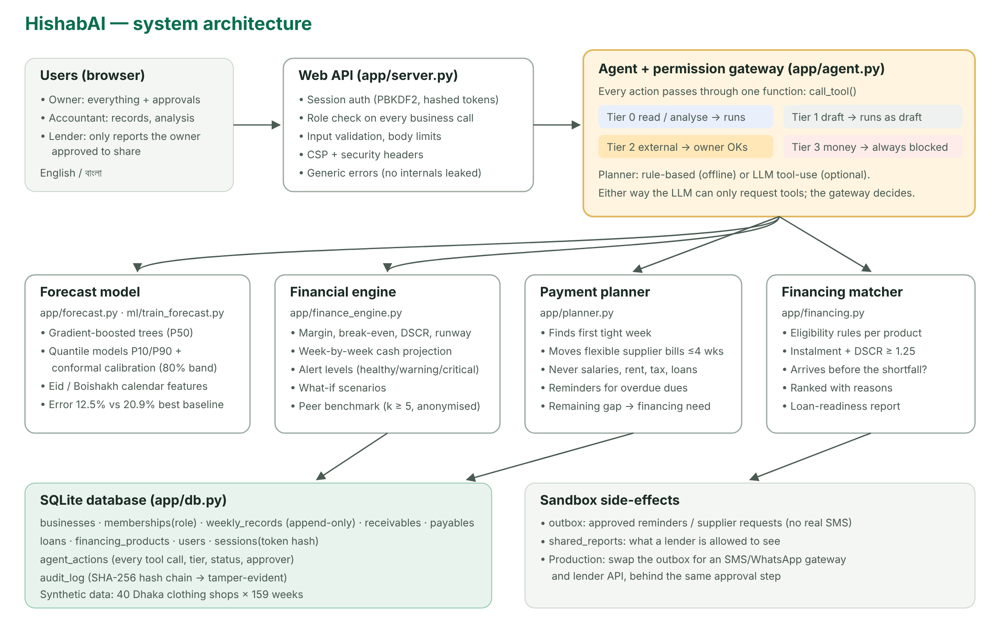
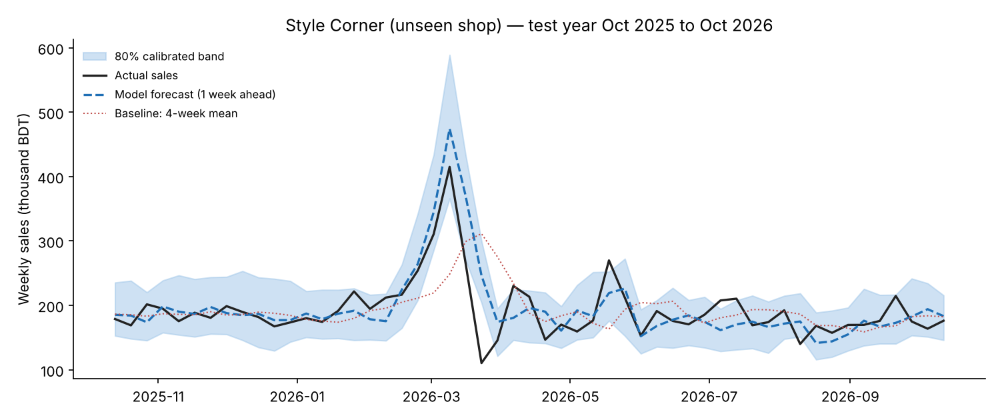

# 1. Problem and solution

**The problem.** Small retailers in Bangladesh (clothing shops, grocers, online sellers) often keep their
accounts in paper ledgers, mobile-wallet histories and memory. Three problems follow:

1. **Shortfalls are discovered too late.** Seasonal businesses buy stock weeks before Eid or winter, while rent,
   salaries, festival bonuses and loan instalments arrive on fixed dates. Owners notice a cash gap only when a
   supplier or employee cannot be paid.
2. **Financing is matched badly.** Owners do not know which products they qualify for or can afford, so they
   turn to expensive informal credit or take loans whose instalments their cash flow cannot carry.
3. **Lenders cannot assess them.** Information is scattered, unstructured and unverified.

**The solution.** HishabAI is an AI agent that takes part in the shop's financial management rather than only
reporting on it:

| Step | What the agent does | Component |
|---|---|---|
| Observe | Reads weekly records, open customer dues (*baki*), supplier bills and loans | Database |
| Predict | Forecasts weekly sales for 8 weeks with a calibrated uncertainty band | Forecast model (ours) |
| Analyse | Projects cash week by week, raises an alert, computes margin, break-even and DSCR | Financial engine |
| Decide | Drafts a payment plan: which bills to move, whom to remind, how much financing is still needed | Payment planner |
| Match | Ranks financing options by eligibility, affordability and speed | Financing matcher |
| Compare | Benchmarks margin, growth, costs, overdue dues, cash buffer and DSCR against anonymised similar shops | Peer benchmarking |
| Act | Queues supplier requests, reminders and lender sharing for **owner approval** | Permission gateway |
| Explain | Briefs the owner in English or Bangla with the numbers behind each step | Agent |

Topic E asks for three capabilities: *financing-option matching, cash-flow management with alerts, and
business financial analysis*. All three are implemented and connected in one agent loop. Business analysis
covers both the shop's own figures and a privacy-preserving comparison with similar shops.

# 2. System architecture



| Layer | Implementation | Notes |
|---|---|---|
| UI | `app/static/` (HTML, CSS, vanilla JS, SVG charts) | No external libraries or CDNs; strict Content-Security-Policy |
| API | `app/server.py` (Python `http.server`, threaded) | JSON API; authentication and role checks on every business endpoint |
| Agent | `app/agent.py` | Tool registry, permission gateway `call_tool()`, approvals, cash check, chat |
| Analytics | `app/finance_engine.py`, `app/planner.py`, `app/financing.py`, `app/benchmark.py` | Deterministic, unit-tested formulas |
| ML | `app/features.py`, `app/forecast.py`, `ml/train_forecast.py` | scikit-learn gradient boosting; features shared by training and serving |
| Data | `app/db.py` (SQLite) | 13 tables including actions, sandbox outbox, shared reports and hash-chained audit log |
| Security | `app/security.py`, `app/audit.py` | Passwords, sessions, lockout, role matrix, tamper-evident log |

**Design choice: minimal dependencies.** The backend uses only the Python standard library plus
numpy/pandas/scikit-learn. A reviewer can run it on any laptop in minutes, and the attack surface stays small.

**Design choice: language model optional.** The agent runs fully offline with a rule-based planner that
understands English and Bangla intents. If an API key is set, an LLM plans the tool calls instead. In both
modes every action passes through the same gateway (Section 5), so the safety properties do not depend on the
model behaving well.

# 3. Data

## 3.1 Synthetic dataset

No public dataset contains weekly cash-flow records of Bangladeshi SMEs, so we built a documented generator
(`data/generate_synthetic.py`, fixed seed). It creates **40 Dhaka clothing shops × 159 weeks**
(2 Oct 2023 – 18 Oct 2026, 6,360 weekly records) encoding these local patterns:

| Pattern | How it is modelled |
|---|---|
| Eid-ul-Fitr peak | Sales rise over the 5 weeks before Eid (up to +150% in the peak week) and drop the week after; per-shop sensitivity 0.7–1.3 |
| Eid-ul-Adha, Pohela Boishakh, winter, monsoon | Smaller uplifts or dips (+35%, +25%, +8%, −10%) |
| Shocks | Random weeks at −40% (e.g. hartal or flooding), probability about 1.2% per week |
| Credit sales (*baki*) | 8–30% of sales; 92% collected after 3 weeks, 5% after 6 weeks, 3% bad debt |
| Stock purchasing | Bought about 3 weeks ahead of demand at (1 − gross margin) of sales |
| Fixed costs | Rent and salaries in the first week of each month; a festival bonus of one month's salary before each Eid; loan instalment around the 10th |
| Owner behaviour | Owner draws a share of the month's cash surplus; injects cash if the balance goes negative |

Open items on 19 Oct 2026 (customer dues, supplier bills, loans) are generated for every shop. The demo shop,
*Style Corner*, has hand-written items that create a realistic winter-stock cash crunch. One of its customer
notes contains a deliberate prompt-injection string used in the security tests.

**Limitation.** Synthetic data lets us develop and test the system against known ground truth. It cannot show
real-world accuracy. A pilot with real shops is the next step (Section 10).

## 3.2 Database schema (SQLite)

| Table | Purpose |
|---|---|
| `users`, `sessions` | Accounts (PBKDF2 hash + salt, lockout fields); session token **hashes** with expiry |
| `businesses`, `memberships` | Business profile; user ↔ business role (`owner`, `accountant`, `lender`) |
| `weekly_records` | Weekly sales, cash/credit split, collections, purchases, fixed costs, cash balance (**append-only** through the API) |
| `receivables`, `payables`, `loans` | Open customer dues, supplier bills (flexible flag, category), loan instalments |
| `financing_products` | Catalogue with eligibility rules (illustrative terms) |
| `agent_actions` | Every tool call: tool, tier, status, parameters, result, requester, approver, expiry |
| `outbox`, `shared_reports` | Sandbox side effects created only by approved tier-2 actions |
| `audit_log` | Hash-chained security and activity log |

# 4. Core algorithms

## 4.1 Sales forecasting model (our own trained model)

**Task.** Given a shop's weekly sales up to week *t*, predict sales for weeks *t+1 … t+8*.

**Approach.** One global model for all shops, trained on *relative* sales so it transfers across shop sizes:

* Scale: *s* = mean sales of the last 12 weeks. Target: log(sales*ₜ₊ₕ* / *s*).
* Features (19): horizon *h*; last four weeks ÷ *s*; 4- and 26-week means ÷ *s*; 12-week trend; last year's ratio
  for the target week; the origin week's distance to Eid-ul-Fitr; and calendar features of the **target** week
  (days to/since each Eid, Eid week, Boishakh week, month).
* Model: `HistGradientBoostingRegressor` (400 trees, learning rate 0.05, 31 leaves, min 40 samples per leaf).
* Uncertainty: two quantile models (P10, P90) give the band. **Conformalised quantile regression** then widens
  it by a margin learned on a held-out calibration window (the last 26 training weeks), so the nominal 80%
  band is honest.

**Evaluation protocol (strict).** Test set = 10 shops never seen in training (every 4th shop, including the
demo shop) × the last 53 weeks (13 Oct 2025 – 12 Oct 2026, which includes both Eids). Training uses the other 30
shops, with targets only before the test period. The model is compared with three baselines computed from the
same information: last week, the 4-week mean, and seasonal naive (last year's same week, rescaled).

| Unseen shops, test year (4,240 forecasts) | WAPE | MAE (BDT/week) | WAPE in pre-Eid weeks |
|---|---|---|---|
| **HishabAI model** | **12.5%** | **23,124** | **12.0%** |
| Baseline: 4-week mean | 20.9% | 38,777 | 36.3% |
| Baseline: last week | 23.4% | 43,466 | 36.0% |
| Baseline: seasonal naive | 24.3% | 44,970 | 35.3% |

* The model cuts error by **40%** compared with the best baseline, and by about **two-thirds** in the weeks
  before Eid, which are the weeks that matter most for cash planning.
* It beats the best baseline at **every horizon** from 1 to 8 weeks (WAPE 12.0–12.7% vs 16.3–22.2%).
* Interval coverage: 71.6% before calibration, **87.9% after** (target 80%). The calibrated band is slightly
  conservative, which suits early warnings.
* A leakage test (`tests/test_forecast.py`) confirms that changing any data after the forecast origin does not
  change the features.



The final served model is retrained on all shops and weeks. Training takes about 20 seconds on a laptop CPU;
the model file is 1.9 MB.

## 4.2 Cash projection and alerts (`finance_engine.project_cash`)

For each future week *w* (forecast sales *Sw*, credit share *c*, purchase ratio *p*, all estimated from the
shop's own history):

```
inflow(w)  = (1 − c)·S_w                           cash sales
           + c·S_(w−3)                              collection of new credit sales (3-week lag)
           + Σ open dues due in w × 0.85            (overdue dues: × 0.50, in week 1)
outflow(w) = p·S_w                                  routine restocking
           + rent + salaries                         if w is the first week of a month
           + festival bonus (one month's salaries)   in the week before an Eid
           + utilities & other (12-week average)
           + loan instalments due in w
           + committed supplier/other bills due in w
closing(w) = closing(w−1) + inflow(w) − outflow(w)
```

The projection runs twice: with the expected forecast (P50) and with the low end of the band (pessimistic).
The **safety buffer** is half a month of rent plus salaries. Alert levels:

* **critical**: expected cash goes below zero;
* **warning**: expected cash goes below the buffer, or pessimistic cash goes below zero;
* **healthy**: otherwise.

Other engine outputs: estimated gross margin (1 − purchases ÷ sales, 52 weeks), break-even sales
(fixed costs ÷ margin), monthly operating cash flow, **DSCR** (operating cash flow ÷ debt service), runway in
weeks, overdue dues, and owner cash injections in the last year (a stress signal).

## 4.3 Payment planner (`planner.draft_payment_plan`)

A greedy, deterministic and explainable algorithm:

1. Project cash. Find the first week below the safety buffer.
2. Among **flexible** open bills due on or before that week, pick the largest. Salaries, rent, tax, utilities and
   loan instalments are never eligible.
3. Try moving it 1–4 weeks later. Keep the option that pushes the first tight week **furthest out**, which buys
   time for financing to arrive; then prefer the highest minimum balance; ties go to the shortest delay.
4. Repeat until no week is below the buffer or no movable bill is left.
5. Add reminders for overdue customer dues. These are not counted in the plan, so the plan stays conservative.
6. Remaining gap = buffer − lowest balance, rounded up to the next ৳10,000 → financing need and the date it is needed by.

**Demo result (Style Corner).** Cash would go negative in week 3 (2 Nov 2026, lowest −৳1,75,475). Moving two
winter-stock bills by 4 weeks shifts the first shortfall to week 7–8. The remaining ৳2,10,000 becomes a financing
need due by 7 Dec 2026.

## 4.4 Financing matcher (`financing.match_financing`)

For each product in the catalogue:

* **Eligibility rules:** amount range, months in business, average monthly sales, collateral, trade licence,
  and women-only schemes.
* **Affordability:** instalment = standard amortisation at the mid-point rate; **DSCR after the loan** =
  operating cash flow ÷ (existing + new instalments), which must be ≥ 1.25.
* **Timing:** is the processing time shorter than the days until the money is needed?
* **Ranking:** eligible first, then fast enough, then lowest total interest. Every option carries readable
  reasons for and against.

For the demo shop the best match is the *women-entrepreneur SME loan*: about ৳9,307 per month, DSCR 1.61,
around 21 days to arrange, which is in time because the supplier extensions bought a month. The bank SME loan
is rejected (collateral required, DSCR 1.21), and so is the digital merchant loan (DSCR 1.07). The catalogue's
terms are **illustrative**; in production they would come from partner lenders.

## 4.5 Loan-readiness report

A structured summary (12 months of sales and purchases, margin, cash flow, DSCR, dues, an 8-week forecast with
range, data provenance and limitations) that a lender can review. It reaches a lender **only** through a tier-2
action the owner approves.

## 4.6 Peer benchmarking (`benchmark.compare_with_peers`)

**Question it answers:** *"Is my shop doing well compared with shops like mine, and where am I losing money?"*

* **Peer group:** same category and district, excluding the shop itself (39 peers for the demo shop).
* **Six measures**, each with a known "better" direction: gross margin ↑, 12-week sales growth vs last year ↑,
  fixed costs as a share of sales ↓, overdue dues as a share of monthly sales ↓, cash buffer in weeks ↑,
  DSCR ↑ (only shops with loans).
* **Statistics:** peer median, 25th and 75th percentiles, and the shop's percentile rank (share of peers it
  beats; ties count half). Rank ≥ 70 → *strong*, < 35 → *needs attention*.
* **Quantified tips** for measures that need attention, e.g. *overdue-dues gap × monthly sales* = cash that would
  be freed by matching the peer level.
* **Privacy:** results are released only when at least **5 peers** exist (k-anonymity). Only medians, quartiles and
  the shop's own rank are returned, never another shop's name, identifier or value. A lender's report contains
  only the shop's percentile ranks.

**Demo result (Style Corner, 39 peers):** gross margin 37.2% vs peer median 32.7% (better than 85%), *strong*;
overdue dues 9.4% of monthly sales vs 4.0% (better than 13%), *needs attention*, so the tip says that matching
peers would free about ৳40,299. The agent links this tip to its reminder actions.

# 5. Agent design: AI as a financial participant

## 5.1 Tools and permission tiers

| Tier | Meaning | Tools | Gateway behaviour |
|---|---|---|---|
| 0 | Read / analyse | `get_financial_summary`, `forecast_sales`, `project_cash_flow`, `run_scenario`, `match_financing`, `compare_with_peers`, `list_receivables` | Runs; logged |
| 1 | Draft | `draft_payment_plan`, `draft_payment_reminder`, `draft_loan_readiness_report` | Runs; output is a draft only |
| 2 | External effect | `send_payment_reminder`, `request_supplier_extension`, `share_report_with_lender` | Validated, then stored as **pending_approval** (expires in 24 h); runs only when the **owner** approves |
| 3 | Money / binding / destructive | `transfer_funds`, `submit_loan_application`, `delete_financial_records` | **Always blocked** and logged, for any user |

`call_tool()` is the only path to any tool. It enforces, in order: known tool → tier-3 block → role permission
(`run_agent` for tiers 0–1, `request_actions` for tier 2) → strict parameter validation (types, enums, lengths,
no unknown fields) → ownership checks (a receivable, bill or lender must belong to this business) → tier
behaviour. For tier 2 it also applies a per-business daily limit and removes duplicate requests.

## 5.2 The autonomous cash check

`run_cash_check()` is the agent's proactive loop. It can be triggered from the UI or on a schedule. It
projects cash; if the alert is not healthy it drafts the payment plan, **queues** one tier-2 action per plan step,
matches financing for the remaining gap, and writes a briefing in English or Bangla that ends with
*"Nothing has been sent and no money has moved. N action(s) are waiting for your approval."*

## 5.3 Conversational interface

* **Offline mode (default):** intent detection for English and Bangla (cash, forecast, what-if, second shop,
  peer comparison, financing, reminders, reports, transfers), amount parsing ("2 lakh", "২.৫ লাখ", "৳50,000"), and replies built
  only from tool outputs.
* **LLM mode (optional):** an Anthropic Messages API tool-use loop (at most 6 steps) over the same tool
  registry. The system prompt requires every number to come from a tool result and states that tool data is
  untrusted. Tool outputs are compacted, and free-text notes are passed in a field named `note_untrusted_text`.
  On any API error the agent falls back to offline mode.

## 5.4 Grounding

The language layer never computes figures. Every amount in a briefing or answer comes from the financial
engine, the planner, the matcher or the forecast model, all of which are unit-tested. This keeps answers
consistent and auditable.

# 6. Security design (summary)

Full details, including the known-risk list, are in the separate *Security Self-Assessment Report*.

* **Authentication:** PBKDF2-HMAC-SHA256 (200,000 iterations, per-user salt); password policy; constant-time
  comparison; lockout after 5 failures for 15 minutes; random 256-bit session tokens stored only as SHA-256
  hashes; 8-hour expiry; logout revokes the token.
* **Authorisation:** role matrix (owner / accountant / lender) checked on every business-scoped request and every
  tool call; strict business isolation.
* **Agent safety:** the permission tiers above, with human approval and expiry for external actions, a hard block
  on money movement, and ownership checks on every referenced record.
* **Data integrity:** weekly records are append-only through the API; validation rejects inconsistent records
  (cash + credit ≠ sales, negative values, non-Monday weeks).
* **Peer privacy:** k-anonymity (at least 5 peers), aggregates only, ranks only for lenders.
* **Auditability:** every tool call is stored in `agent_actions`; security events go to a SHA-256 hash-chained
  `audit_log`, whose verification detects any edited or deleted row.
* **Web hardening:** strict CSP (no inline script, no eval, no third-party origins), X-Frame-Options DENY, nosniff,
  no-referrer, `Cache-Control: no-store`, 64 KB body limit, JSON content-type enforcement, generic 500 errors,
  and a static-file whitelist (no path traversal). The UI inserts all data with `textContent`, never `innerHTML`.

# 7. Testing and evidence

| Suite | Tests | Covers |
|---|---|---|
| `test_finance_engine.py` | 10 | Formatting, amortisation, break-even, projection arithmetic, scenario validation |
| `test_forecast.py` | 4 | Band ordering, short-history fallback, **no future leakage**, model beats baselines |
| `test_planner_financing.py` | 7 | Plan buys time, extension limits, non-deferrable bills, eligibility rules, ranking |
| `test_security.py` | 9 | Hashing, password policy, lockout, token hashing/expiry/logout, role matrix, isolation, audit tampering |
| `test_agent.py` | 21 | Tier enforcement, approval/rejection/expiry/duplicates, validation, cross-business refs, **prompt-injected LLM**, Bangla |
| `test_benchmark.py` | 7 | Peer statistics, demo profile, tip arithmetic, **k-anonymity threshold**, no peer data leakage, lender sees ranks only |
| `test_api.py` | 9 | 401/403/404/400/413/409 paths, security headers, benchmark access, end-to-end approval → lender visibility |

**Total: 67 tests, all passing** (`evidence/test_results.txt`). The end-to-end script `scripts/run_demo.py` runs 22
checks against the live server and records every request and response (`evidence/execution_log.jsonl`,
`evidence/EXECUTION_EVIDENCE.md`): **22/22 pass**.

# 8. Innovation and user experience

1. **An agent that acts safely.** It proposes concrete actions (supplier extensions, reminders, lender sharing),
   prepares them fully with message previews, and executes them only with one-tap owner approval. Money
   movement is impossible by construction.
2. **Time-aware financing.** The planner and matcher work together: rescheduling buys time, and the matcher
   checks whether a cheaper loan can arrive before the gap. The shop can then use a concessional loan instead
   of expensive emergency credit.
3. **Local intelligence.** Eid, Boishakh and festival-bonus effects are built into both the model and the cash
   engine. The lakh/crore number format and Bangla interaction suit owners who do not use English.
4. **Benchmarking without exposing anyone.** Owners learn where they stand against similar shops, with a taka
   figure for each gap, while k-anonymity keeps every shop's data private.
5. **Measured, not claimed.** The forecast is benchmarked on unseen shops with calibrated uncertainty; safety
   claims are backed by automated tests and logged evidence.

# 9. AI components and business model

| AI component | Role |
|---|---|
| **Our own trained model** | Weekly sales forecaster (Section 4.1): our contribution, trained and evaluated by the team |
| **Pretrained foundation model (optional)** | An LLM (Claude via API) for free-form conversation and tool planning; bounded by the permission gateway; the agent runs offline without it |

**Who pays.** Shops never pay per message. Forecasts, alerts, plans, financing matching, benchmarking and the
offline agent run on our own code at near-zero marginal cost. The LLM is used only for free-form questions, with
smaller models and daily limits. Revenue: (1) banks, NGOs and microfinance institutions pay for consented,
structured loan-readiness reports that lower their assessment cost and default risk; (2) an optional premium plan
for unlimited AI conversation. Network effect: each new shop improves peer benchmarks for all.

# 10. Limitations and roadmap

| Limitation | Plan |
|---|---|
| Synthetic data only | Pilot with 10–20 Dhaka shops; import mobile-wallet and bank statements; retrain and re-evaluate |
| Illustrative financing terms | Partner with lenders and MFIs for verified product terms; add an API for applications that the owner submits |
| Sandbox outbox | Connect an SMS/WhatsApp gateway behind the same approval step |
| Manual or CSV data entry | Photo-of-ledger (khata) capture with OCR and owner confirmation |
| Single-node SQLite, no TLS in the dev server | Deploy behind HTTPS reverse proxy; PostgreSQL with row-level security; secrets manager |
| Rule-based Bangla intents | LLM mode for open questions; Bangla evaluation set |
| Peer groups from one category and city | More categories and districts as shops join; differential-privacy noise for small groups |

# 11. How to run

Source code: **https://github.com/PIXEL-L00P/hishab-copilot**. See `README.md`. In short: `pip install -r requirements.txt`, `python scripts/seed_db.py`,
`python -m app.server`, then open http://127.0.0.1:8000 and sign in as `farhana` / `StyleCorner#2026`.
